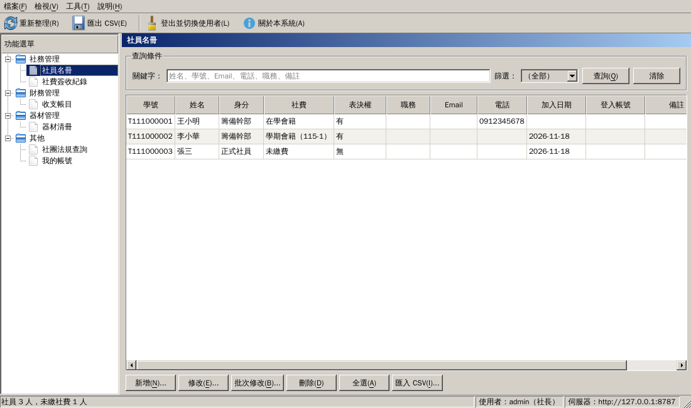

# 北科無人機社 社務管理系統（桌面版）



安裝在電腦上使用的社務管理程式，採正統 Windows 98 / 2000 經典視窗介面（灰色 3D 浮雕按鈕、下凹輸入框、新細明體 9 點點陣字、經典深藍選取列、MMC 漸層標題列、選單列、工具列、左側功能樹、狀態列）。
程式直接連到社團網站的後端（Cloudflare Workers），**資料與網站後台共用**：在桌面版修改的內容，網站上會立即看到，反之亦然。

## 🌟 1.2.0 重點特色與完整功能

### 功能列表

| 功能分類 | 功能名稱 | 可使用的角色 | 說明 |
| :--- | :--- | :--- | :--- |
| **社團通訊** | 聊天室 | 所有人 | 全體聊天室、幹部限定群組、指定成員小組、公告用唯讀頻道；支援訊息編輯與刪除 |
| | 私人訊息 | 所有人 | 與社團成員一對一私訊，具備已讀標記與即時輪詢刷新 |
| | 社團公告 | 所有人（發布限幹部） | 社團重大事項公告，支援置頂、幹部限定、已讀名單統計、連動外部推播 |
| | 系統匣與未讀提示 | 所有人 | 縮小至系統匣背景執行，新訊息氣泡推播提示，功能樹即時顯示紅色未讀計數徽章 |
| **網站管理** | 文章管理 | 社長、一般幹部 | 官網最新消息與部落格發布；完整 Markdown 工具列、即時預覽、本機自動存檔草稿、.md 匯入匯出與全站打包備份 |
| | 獨立頁面管理 | 社長、一般幹部 | 自訂客製化介紹頁面（如 `/page/join` 等），免改後端程式碼即可新增編輯 |
| | 首頁外觀設定 | 社長、一般幹部 | 調整官網首頁 Hero 標題、說明文字、加入社團按鈕連結與引導文字 |
| | 外部推播設定 | 社長 | 選用推播模組：支援 Discord、Slack、Google Chat、Microsoft Teams Webhook 與 LINE 官方帳號廣播（Messaging API） |
| **會議與大會** | 會議與社員大會 | 所有人（幹部可主持） | 定期／臨時社員大會、幹部會議；AI 產生開會通知、現場學號簽到碼、應出席法定人數自動試算、無記名線上投票（章程門檻自動判定）、現場紀錄與 AI 一鍵生成正式會議紀錄並定稿 |
| **AI 工具** | AI 助理 | 所有人 | 聊天式查詢社費、帳目、設備、法規條文與表單進度，並提供快捷操作建議 |
| | 每週社務報告 | 幹部 | 每週一自動統整社務狀態，AI 生成財務、社員動態、器材借用與待辦摘要 |
| | AI 整理名單 | 社長、財務 | 貼上雜亂文字或非結構化名單，AI 自動分析並整理成社員匯入表格 |
| | AI 財務審查 | 社長、財務 | 智慧比對重疊交易、超過 14 天待審核款項、自動推薦預算科目分類 |
| | 舊帳本 CSV 匯入 | 社長、財務 | 相容歷屆 Excel 與 Google 試算表格式，智慧辨識收入、支出與劃撥轉帳 |
| **行政與財務** | 社員名冊 | 社長、財務 | 查詢、篩選、新增、修改、刪除、全選與批次修改身分或社費、匯入 CSV |
| | 社費簽收紀錄 | 社長、財務 | 登錄社費簽收（自動更新社員社費狀態）、刪除紀錄、本學期合計 |
| | 收支帳目 | 社長、財務 | 帳戶摘要、新增收支、社長核准／退回、刪除已退回帳目、預算分類與執行率 |
| | 器材清冊 | 社長、財務、幹部 | 查詢、新增、修改器材（財產編號由伺服器自動產生） |
| **表單作業** | 紙本簽核表單 | 所有人（社員限查個人） | 六種紙本表單：社費支出事前申請單、事後報銷單、設備借據、學生活動申請表、活動報告表、公文。可新增、修改、刪除、列印空白或填寫後表單 |
| | 　└ AI 協助填寫 | 所有人（公文限幹部） | 口語描述借用或報銷事由，AI 自動對應填寫至表單對應欄位 |
| | 　└ AI 白話轉公文 | 幹部以上 | 白話事由一鍵潤飾改寫為合乎學校規範之函、簽、公告格式 |
| **系統與輔助** | 社團法規查詢 | 所有人 | 唯讀瀏覽最新生效之組織章程、各級施行細則與學校法規 |
| | 我的帳號 | 所有人 | 檢視綁定之社員身分、表決權資格、歷年社費紀錄、變更登入密碼 |
| | 內建使用教學 | 所有人 | 隨時按下 **F1 鍵** 或從「說明 → 使用教學」查看全功能操作手冊 |
| | 首次啟動導覽 | 所有人 | 首次安裝登入後自動彈出歡迎精靈，指引快速上手 |

* 每個表格都可以用「檔案 → 匯出 CSV」（Ctrl+E）匯出成 Excel 可開啟的檔案。F5 重新整理。
* 表單列印會用瀏覽器開啟 A4 版面，再按「列印／另存 PDF」。
* AI 功能使用網站設定的 `GROQ_API_KEY`（或 `GEMINI_API_KEY`），每人每日有使用次數上限；網站沒設定金鑰時按鈕會自動停用。
* 權限與網站後台相同，由伺服器判斷；看不到的功能代表您的帳號角色沒有權限。

## 🎨 經典復古介面設計 (Windows 98 / 2000 Authentic Look)

桌面版採用考究的 90 年代末至 2000 年代經典 Windows 視窗美學：
1. **立體 3D 浮雕按鈕**：頂左亮白（`#FFFFFF`）、底右深灰（`#404040`）立體陰影，按下時凹陷反轉。
2. **經典下凹輸入框**：輸入框、文字區、表格採用頂左深灰、底右亮白的 Sunken 凹陷雕刻感。
3. **經典 CJK 點陣字型**：自動載入 Windows 內建新細明體（`mingliu.ttc`）9 點（9pt = 12px 點陣最佳閱讀尺寸），字型筆觸工整清晰。
4. **MMC 風格漸層標題列**：各功能頁面頂部配備微軟管理主控台（MMC）經典深藍漸層標題橫幅（`#000080` 至 `#1084d0`）。
5. **經典控制項與狀態列**：具備下凹面板分區的 QStatusBar、傳統立體捲軸與分頁標籤。

## 安裝

1. 到 GitHub 儲存庫的 **Releases**，下載最新的 `ClubDesk-Setup-1.2.0.exe`（約 15–20 MB）。
2. 執行安裝程式，依照精靈「下一步」即可。預設只安裝給目前的使用者，**不需要系統管理員權限**；會建立開始功能表捷徑，可選擇建立桌面捷徑。
3. 第一次執行時 Windows 可能顯示「Windows 已保護您的電腦」（程式沒有付費的程式碼簽章），按「其他資訊 → 仍要執行」。
4. 登入畫面輸入：
   * **伺服器網址**：社團網站的網址，例如 `https://ntut.tpe.pp.ua` 或 `https://ntut-drone-web.xxxx.workers.dev`
   * **帳號／密碼**：與網站後台相同
   * **驗證碼**：與網站登入相同的圖片驗證碼

解除安裝：Windows「設定 → 應用程式」或開始功能表的「解除安裝」。

> 若網站設定了 Cloudflare Turnstile（`TURNSTILE_SECRET_KEY`），桌面版無法登入，需改用網站內建的圖片驗證碼。

## 自動更新

程式每次開啟登入畫面時，會向網站的 `GET /api/desktop/version` 詢問最新版本。有新版本時會詢問是否更新，按「立即更新」後：

1. 從 GitHub Release 下載新的安裝程式（顯示下載進度）。
2. 核對 SHA-256，與社長發布的不符就刪除，不會執行。
3. 執行安裝程式並關閉舊版，安裝完成即是新版本（社員資料都在網站上，不受影響）。

也可以從「說明 → 檢查更新」手動檢查。社長可把某個版本設為「必要更新」，舊版就必須更新才能使用。

### 發布新版本（給維護者）

1. 修改 `desktop/clubdesk/__init__.py` 的 `__version__`，例如 `1.2.0`，合併到 `main`。
2. 在 `main` 上建立並推送標籤 `desktop-v1.2.0`：
   ```bash
   git tag desktop-v1.2.0
   git push origin desktop-v1.2.0
   ```
3. GitHub Actions（Desktop App）會自動打包安裝程式，並建立 GitHub Release，說明中附上 SHA-256。
4. 社長用桌面版「工具 → 發布桌面版更新」，按「從 GitHub 最新 Release 帶入」，確認後按確定。之後所有社員開啟程式就會收到更新通知。

網站端只接受 `https://github.com/` 的下載網址，且只有社長能發布。

## 檔案大小

只打包程式用到的 Qt 元件（QtCore、QtGui、QtWidgets、QtSvg），不含 QML、Quick、PDF、網路模組與 20 MB 的軟體 OpenGL，HTTP 使用 Python 內建的 urllib。
安裝程式約 15–20 MB，安裝後約 50 MB；打包流程會檢查安裝程式不得超過 50 MB。

## 開發者：從原始碼執行與測試

需要 Python 3.10 以上（建議 3.12）。

```bash
cd desktop
python -m venv .venv
.venv\Scripts\activate
pip install -r requirements.txt
python main.py
```

（macOS／Linux 的啟用指令為 `source .venv/bin/activate`。）

連到本機測試伺服器：在專案根目錄執行 `npx wrangler dev`，登入畫面的伺服器網址填 `http://127.0.0.1:8787`。

### 執行單元測試

單元測試包含完整的後端 API 模擬測試（`test_api.py`）與版本更新校驗測試（`test_updater.py`）：

```bash
cd desktop
python -m unittest discover -s tests -v
```

若使用 pytest：
```bash
python -m pytest tests/
```

### 離線測試（無螢幕環境 Offscreen）

在無桌面環境（例如 Linux CI/CD 或遠端 SSH）下測試所有 Qt 畫面與對話框：

```powershell
$env:QT_QPA_PLATFORM="offscreen"
python -m unittest discover -s tests -v
```

### 自行打包安裝程式（Windows）

需安裝 [Inno Setup 6](https://jrsoftware.org/isinfo.php)：

```bash
pip install pyinstaller
pyinstaller --noconfirm ClubDesk.spec
iscc /DAppVersion=1.2.0 installer\ClubDesk.iss
```

安裝程式產生在 `desktop/dist/ClubDesk-Setup-1.2.0.exe`。

## 程式結構

```
desktop/
├── main.py                 程式進入點
├── ClubDesk.spec           PyInstaller 打包設定（精簡 Qt 元件）
├── installer/              Inno Setup 安裝精靈腳本與繁體中文語系檔
│   ├── ClubDesk.iss        安裝程式腳本
│   └── ChineseTraditional.isl 繁體中文語系檔
├── clubdesk/
│   ├── api.py              與網站後端溝通（/api/*）、登入與驗證碼、社團通訊與網站管理 API
│   ├── updater.py          檢查、下載、驗證並安裝新版本；社長發布更新
│   ├── formschema.py       六種表單的欄位定義（與 src/forms.js 一致）
│   ├── style.py            經典 Windows 98 / 2000 復古外觀樣式表與新細明體點陣字型加載
│   ├── widgets.py          共用表格、頁面框架、錯誤訊息提示
│   ├── login.py            登入視窗
│   ├── mainwindow.py       主視窗（選單、工具列、功能導覽樹、狀態列、系統匣通知）
│   └── pages/              各功能畫面（通訊、網站、文章、頁面、會議、AI、財務、器材、社員等）
└── tests/
    ├── test_api.py         API 完整單元測試（FakeTransport 涵蓋所有新舊端點）
    └── test_updater.py     版本比對與 GitHub Release 解析單元測試
```

使用 Python + PySide6（Qt）撰寫原生視窗介面，不使用肥大的網頁打包技術。
`installer/ChineseTraditional.isl` 取自 Inno Setup 專案的非官方繁體中文翻譯。
